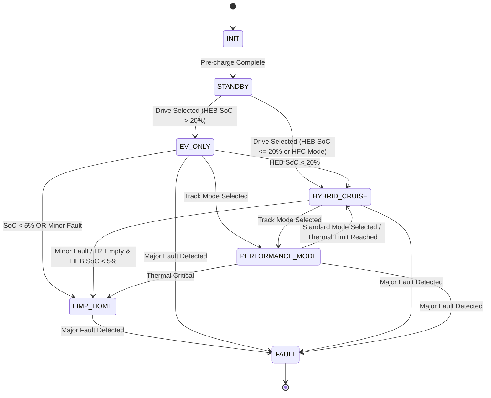

# Energy-Management State Machine & Power Allocation

## 1. Overview
This document describes the **target** Energy Management System (EMS) for the three-source powertrain: the Hydrogen Fuel Cell (HFC) is the primary continuous power source, the High-Energy Battery (HEB) supplies bulk storage and balances demand, and the Supercapacitor Bank (SCB) handles short transients and regenerative-braking peaks. Component power/energy allocations and fault responses are defined provisionally in the [powertrain requirements baseline](triple_hybrid_spec.md).

This is not current runtime behavior: `helios-energy` and `helios-twin` model the battery only and do not implement HFC or SCB dispatch. Battery source limits in the model are assumptions, not qualified hardware limits.

## 2. Power Allocation Rules

### 2.1 Discharge (Acceleration)
1. **Transient / High-Peak Demand (e.g., Launch Control, Hard Acceleration):**
   - HFC supplies the scheduled continuous baseline, clamped to its current available net output and OEM slew limits.
   - SCB supplies the transient increment only while within voltage, current, temperature, energy, and converter limits.
   - HEB supplies the remaining demand within its live state-of-power. If sources cannot meet demand, limit torque rather than exceeding a source limit.
2. **Sustained Highway Cruising:**
   - HFC is the primary continuous source. Select its operating point from the validated supplier efficiency/ramp map; no efficient setpoint is established in this project yet.
   - HEB buffers load changes and supplies demand above HFC output. Maintain SCB energy/voltage headroom for both propulsion transients and regenerative braking; do not prescribe an 80% reserve until the module's SOC/voltage relationship and use case are validated.
3. **Low-Speed / City Driving:**
   - In hybrid operation, HFC remains the primary continuous source and HEB balances demand. An explicitly selected `EV_ONLY` mode may disable HFC only if supported by the selected system safety concept and energy reserve.

### 2.2 Charge (Regenerative Braking)
1. **High-Power Regen (Hard Braking):**
   - SCB absorbs the initial high-current spike up to its live charge limit (500 kW for 5 s is a provisional allocation, not a selected hardware rating).
   - HEB accepts remaining energy only within its live charge SOP and the provisional 150 kW / 10 s application cap. The twin has a modeled 8C ceiling but does not enforce this application cap or assert a regen-power acceptance threshold yet.
   - Friction brakes provide the remainder whenever either electrical source is limited, unavailable, or invalid.
2. **Low-Power Regen (Coasting):**
   - Route to the source with available charge acceptance and energy headroom; prioritize total system constraints and battery/capacitor thermal limits over a fixed source preference.

### 2.3 Active Downforce (AGEDS) Operation
- **Track/Performance Mode:** The fan load is a separate provisional auxiliary load (currently not represented in the energy twin).
  - **Power Allocation:** Include auxiliary loads in total demand. HFC remains slew- and availability-limited; HEB supplies any shortfall only within its live SOP.
  - **Fault Handling:** On HFC fault, reduce auxiliary/traction demand to available HEB/SCB capability. Shed or disable non-safety-critical loads before propulsion reserve is exhausted. Any AGEDS safe-state action must be defined by chassis and vehicle-safety analysis, not by battery SOC alone.

## 3. State Machine Logic

The EMS operates using the following state machine:

### States

- `INIT`: System self-check, pre-charging DC link.
- `STANDBY`: Contactor closed, awaiting drive mode selection.
- `EV_ONLY`: Optional exception with HFC disabled; running on HEB and SCB.
- `HYBRID_CRUISE`: HFC active, providing baseline power. HEB/SCB handle transients.
- `PERFORMANCE_MODE`: All available sources may be used within their instantaneous limits. HFC follows its validated operating/ramp map, HEB supplies sustained demand, and SCB retains validated transient and regenerative headroom.
- `LIMP_HOME`: Degraded operation only where the fault analysis and remaining source capability permit it; no fixed 50 kW limp-home rating is established yet. Isolate a failed source and clamp torque to remaining live limits.
- `FAULT`: Safety violation. High voltage system disconnected.

### State Transitions



## 4. Control Loop (Pseudocode)

```rust
// Conceptual target strategy only; not implemented by the current energy crate.
// EMS Control Loop - 10ms execution cycle
loop {
    let torque_demand = read_driver_input();
    let power_demand_kw = calculate_power(torque_demand, motor_rpm);
    
    match current_state {
        State::PerformanceMode => {
            // 1. AGEDS (Active Downforce) has highest priority in performance mode
            let downforce_req_kw = calculate_ageds_power(vehicle_speed, lateral_g);
            command_ageds_fans(downforce_req_kw);
            
            // Adjust total power demand to include auxiliary systems
            let total_demand = power_demand_kw + downforce_req_kw;

            // 2. HFC supplies continuous power first, including available auxiliary load.
            let hfc_pwr = min(total_demand, HFC_AVAILABLE_OUTPUT);
            let rem_pwr_1 = total_demand - hfc_pwr;

            // 3. SCB supplies only the transient portion above the HFC contribution.
            let scb_pwr = min(transient_demand(rem_pwr_1), SCB_AVAILABLE_DISCHARGE);
            let rem_pwr_2 = rem_pwr_1 - scb_pwr;
            
            // 4. HEB supplies the sustained remainder within its limits.
            let heb_pwr = min(rem_pwr_2, HEB_AVAILABLE_DISCHARGE);
            
            command_inverters(scb_pwr, hfc_pwr, heb_pwr);
        },
        State::HybridCruise => {
            // HFC is the continuous baseline; HEB balances demand and buffers changes.
            let hfc_pwr = min(power_demand_kw, min(HFC_EFFICIENT_OUTPUT, HFC_AVAILABLE_OUTPUT));
            let heb_pwr = min(power_demand_kw - hfc_pwr, HEB_AVAILABLE_DISCHARGE);
            let scb_pwr = 0.0; // Reserve SCB for transients
            command_inverters(scb_pwr, hfc_pwr, heb_pwr);
        },
        // ... handling for other states
    }
    
    sleep(10_ms);
}
```
