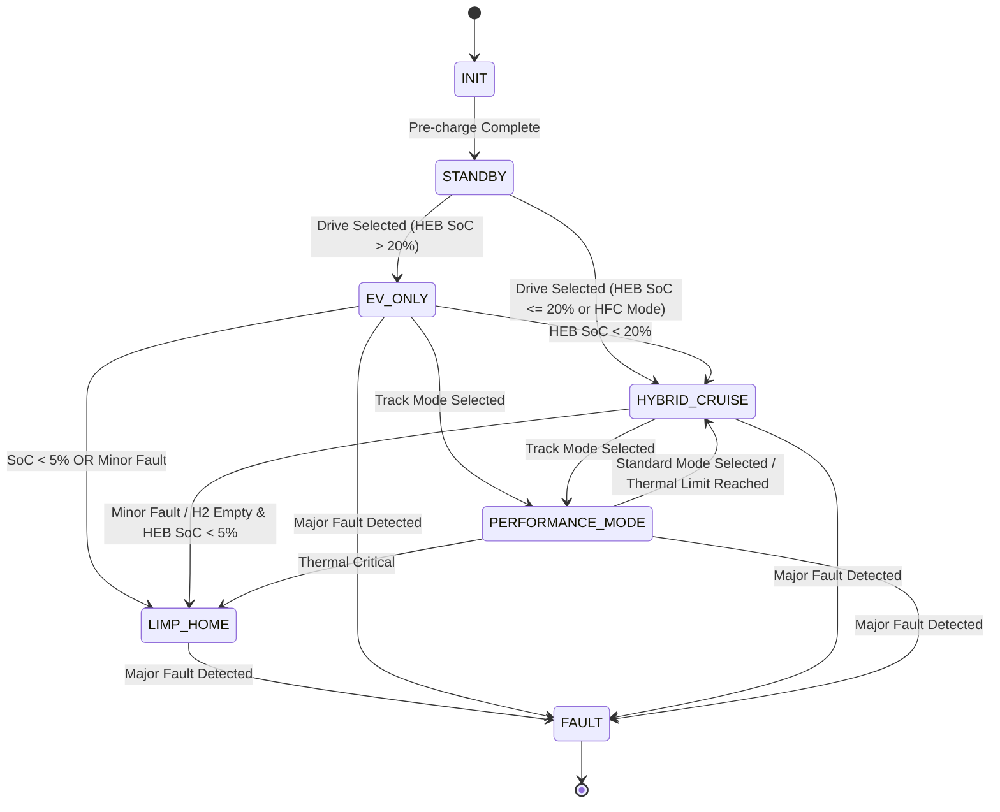

# Energy-Management State Machine & Power Allocation

## 1. Overview
This document describes the **target** Energy Management System (EMS) for the three-source powertrain: the Hydrogen Fuel Cell (HFC) is the primary continuous power source, the High-Energy Battery (HEB) supplies bulk storage and balances sustained demand, and the Supercapacitor Bank (SCB) handles short high-power transients and regenerative-braking spikes. It is a design specification, not a description of current runtime behavior: `helios-energy` and `helios-twin` currently model the battery and do not yet implement HFC or SCB dispatch.

## 2. Power Allocation Rules

### 2.1 Discharge (Acceleration)
1. **Transient / High-Peak Demand (e.g., Launch Control, Hard Acceleration):**
   - HFC supplies its scheduled continuous baseline, up to its available output.
   - SCB supplies short high-current bursts; HEB supplies the sustained demand and any power beyond HFC/SCB limits.
2. **Sustained Highway Cruising:**
   - HFC is the primary continuous source and operates near its efficient setpoint (e.g., 30-50 kW).
   - HEB buffers load changes and supplies demand above HFC output. SCB is kept near its target reserve (e.g., ~80% SoC) for sudden overtakes.
3. **Low-Speed / City Driving:**
   - In hybrid operation, HFC remains the primary continuous source and HEB balances demand. An explicitly selected `EV_ONLY` mode may disable HFC; it is an exception to the normal hybrid strategy.

### 2.2 Charge (Regenerative Braking)
1. **High-Power Regen (Hard Braking):**
   - SCB absorbs the initial high-current spike (up to 500 kW), within its voltage, temperature, and state-of-charge limits.
   - HEB accepts remaining energy within its own charge limits; friction brakes provide the remainder when both electrical sources reach their limits.
2. **Low-Power Regen (Coasting):**
   - **Primary:** Routed directly to HEB to maximize overall energy retention.

### 2.3 Active Downforce (AGEDS) Operation
- **Track/Performance Mode:** The twin Schübeler fans draw up to 18 kW continuously to maintain underbody vacuum.
  - **Power Allocation:** Prioritize available HFC output for the fan load; HEB supplies any shortfall. Respect source and thermal limits rather than assuming the HFC can always increase output.
  - **Fault Handling:** If HFC faults, HEB assumes the load. If HEB SoC drops below 10%, AGEDS RPM is throttled, reducing downforce to extend range and preserve thermal limits.

## 3. State Machine Logic

The EMS operates using the following state machine:

### States

- `INIT`: System self-check, pre-charging DC link.
- `STANDBY`: Contactor closed, awaiting drive mode selection.
- `EV_ONLY`: Optional exception with HFC disabled; running on HEB and SCB.
- `HYBRID_CRUISE`: HFC active, providing baseline power. HEB/SCB handle transients.
- `PERFORMANCE_MODE`: All sources available. HFC supplies up to its continuous limit, HEB supplies sustained demand, and SCB is held at a target SoC that leaves regen headroom.
- `LIMP_HOME`: Critical fault or low SoC. Power limited to 50 kW. SCB disabled.
- `FAULT`: Safety violation. High voltage system disconnected.

### State Transitions



## 4. Control Loop (Pseudocode)

```rust
// Conceptual target strategy only; not implemented by the current energy crate.
// EMS Control Loop - 10ms execution cycle
loop {
    let torque_demand = read_driver_input();
    let power_demand_kw = calculate_power(torque_demand, motor_rpm);
    
    match current_state {
        State::PerformanceMode => {
            // 1. AGEDS (Active Downforce) has highest priority in performance mode
            let downforce_req_kw = calculate_ageds_power(vehicle_speed, lateral_g);
            command_ageds_fans(downforce_req_kw);
            
            // Adjust total power demand to include auxiliary systems
            let total_demand = power_demand_kw + downforce_req_kw;

            // 2. HFC supplies continuous power first, including available auxiliary load.
            let hfc_pwr = min(total_demand, HFC_AVAILABLE_OUTPUT);
            let rem_pwr_1 = total_demand - hfc_pwr;

            // 3. SCB supplies only the transient portion above the HFC contribution.
            let scb_pwr = min(transient_demand(rem_pwr_1), SCB_AVAILABLE_DISCHARGE);
            let rem_pwr_2 = rem_pwr_1 - scb_pwr;
            
            // 4. HEB supplies the sustained remainder within its limits.
            let heb_pwr = min(rem_pwr_2, HEB_AVAILABLE_DISCHARGE);
            
            command_inverters(scb_pwr, hfc_pwr, heb_pwr);
        },
        State::HybridCruise => {
            // HFC is the continuous baseline; HEB balances demand and buffers changes.
            let hfc_pwr = min(power_demand_kw, min(HFC_EFFICIENT_OUTPUT, HFC_AVAILABLE_OUTPUT));
            let heb_pwr = min(power_demand_kw - hfc_pwr, HEB_AVAILABLE_DISCHARGE);
            let scb_pwr = 0.0; // Reserve SCB for transients
            command_inverters(scb_pwr, hfc_pwr, heb_pwr);
        },
        // ... handling for other states
    }
    
    sleep(10_ms);
}
```
